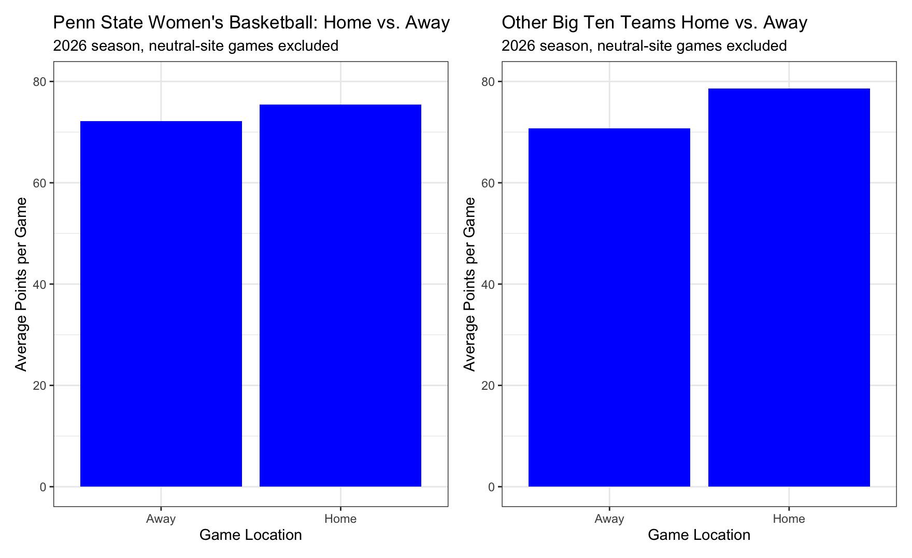

# Homework 4.3: Reproducible Data Analysis

This repository contains my STAT 184 Homework 4.3 project. The project uses R and Quarto to combine multiple data analyses into a reproducible PDF document.

## Overview

The report contains five main sections:

1. Descriptive statistics for diamond length, width, and depth, separated by cut quality.
2. A comparison of Penn State’s home and away scoring averages with those of the other Big Ten women’s basketball teams.
3. Monte Carlo numerical integration of the standard normal curve.
4. A comparison of plan-informed and generic GenAI responses for analyzing calcium data.
5. A reflection on the problem-solving skills I have developed in STAT 184.

The report also includes a GenAI Usage Appendix and a Code Appendix.

[View the rendered report](hw4.3.pdf)

### Interesting Insight

One interesting result is that Penn State had a much smaller home–away scoring difference than the other Big Ten teams combined. Penn State averaged approximately 73 points per game away and 75 points at home, while the other Big Ten teams averaged approximately 71 points away and 79 points at home. This means Penn State’s home–away difference was about 2 points, compared with about 8 points for the other teams. Although these averages do not explain why the difference exists, they show how a visualization can reveal a pattern that may be worth exploring further.

## Data Sources and Acknowledgements

This project uses the following data:

- `diamonds`, a dataset included with `ggplot2` containing individual diamond measurements and characteristics.
- `games_copy.csv`, a course-provided NCAA women’s basketball dataset.
- `calcium.csv`, a course-provided dataset containing calcium measurements for 31 women.

The analysis was completed using R, Quarto, `ggplot2`, `tidyverse`, and `kableExtra`. All uses of generative AI are documented in the GenAI Usage Appendix of the report.

## Current Plan

The Homework 4.3 report is complete. My current plan is to finish the repository documentation, verify that all supporting files are included, and check that the report renders successfully from the repository.

Changes are developed on the `dev-Andrew` branch. GitHub issues identify required work, descriptive commits document changes, and pull requests merge completed work into `main`.

See [PLAN.md](PLAN.md) for the detailed goals, needs, and steps for both the analysis project and repository maintenance.

## Repo Structure

- `hw4.3.qmd` — Quarto source document containing the analysis, narrative, and R code.
- `hw4.3.pdf` — Submitted Homework 4.3 PDF report.
- `games_copy.csv` — Basketball dataset stored using Git LFS.
- `calcium.csv` — Calcium dataset used in the planning and prompting analysis.
- `images/static_images/` — Supporting static image used in the report.
- `PLAN.md` — Detailed analysis and repository maintenance plans.
- `HW4.4_Template.Rproj` — RStudio project file.
- `optional_files/` — Optional citation and coding-style resources.
- `README.md` — Project overview and repository information.

To reproduce the report, install Git LFS, clone the repository, and run `git lfs pull` inside the repository folder. Open the RStudio project and install `tidyverse` and `kableExtra` if necessary. With Quarto and a LaTeX distribution installed, open `hw4.3.qmd` and click Render.

## Authors

Andrew Speer  
STAT 184, Penn State  
GitHub: [andrewjs8](https://github.com/andrewjs8)

For questions about this project, email: andrewjspeer@gmail.com
